<!--
  Методи відновлення ОС
  Варіант 2: Невдале встановлення програми — `/f` — 41 — Визначити обсяг місця, відведений під точки відновлення

  Тему, мету й обладнання писати не треба — конвеєр візьме їх із лабораторної.
  Знімки екрана кладіть у assets/, вихідний код — у src/.
  Контрольні питання — лише одного рівня, того, на який захищаєте роботу:
  заголовок «### Достатній рівень», далі «1 Текст питання?» і відповідь.
  Покрокова інструкція — reports/README.md
-->

## Хід роботи

1 Отримала в викладача індивідуальний варіант №2 згідно з таблицею варіантів.

2 Зафіксувала початкові параметри операційної системи: перевірила версію та збірку Windows, час останнього завантаження, стан середовища відновлення WinRE (`reagentc /info`) та стан захисту для системного диска `C:`. Зробила відповідні знімки екрана.

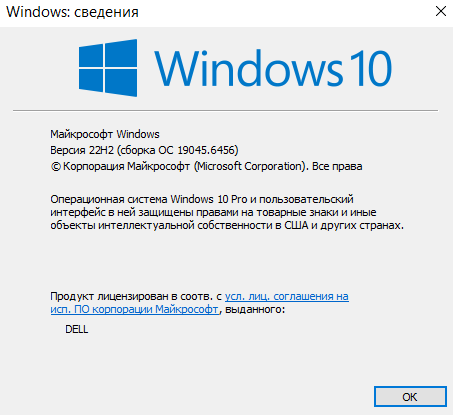

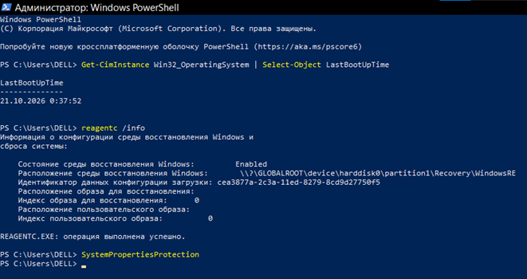

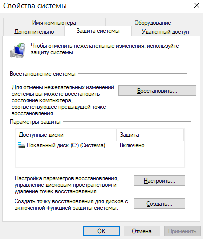

3 Увімкнула захист для системного диска `C:` та створила контрольну точку відновлення системи з описом, що містить моє прізвище: `Lab_Butko_RestorePoint`. За допомогою PowerShell вивела перелік точок відновлення (`Get-ComputerRestorePoint`) та зафіксувала порядковий номер 3 створеної точки (Sequence Number).

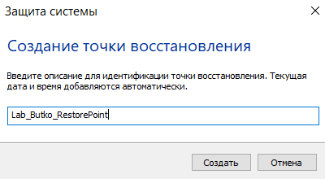

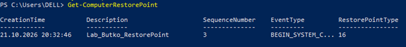

4 Виконала перевірку сховища компонентів (`DISM /Online /Cleanup-Image /ScanHealth`) та перевірку цілісності системних файлів (`sfc /scannow`) у правильному порядку. За допомогою командного рядка зберегла витяг із системного журналу CBS у файл `sfc_log.txt` на робочому столі.

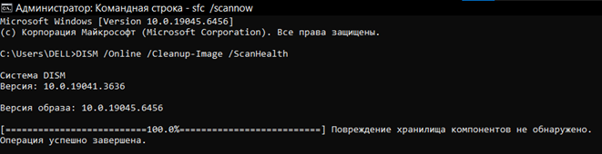

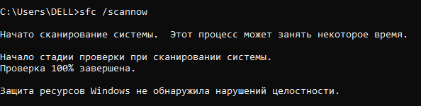

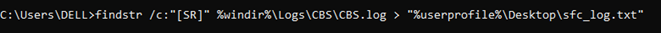

5 Виконала перевірку файлової системи несистемного тому `D:` з ключем свого варіанта `/f` (`chkdsk D: /f`). Помилок не виявлено.

   * **Пояснення:** Для системного тому (диска `C:`) перевірка за допомогою `chkdsk` відкладається до наступного перезавантаження, тому що цей диск постійно використовується операційною системою (на ньому відкриті системні файли, реєстр, файл підкачки тощо). ОС не може заблокувати або розмонтувати системний диск «на льоту» під час активної роботи, тому пропонує запланувати перевірку перед завантаженням графічної оболонки.

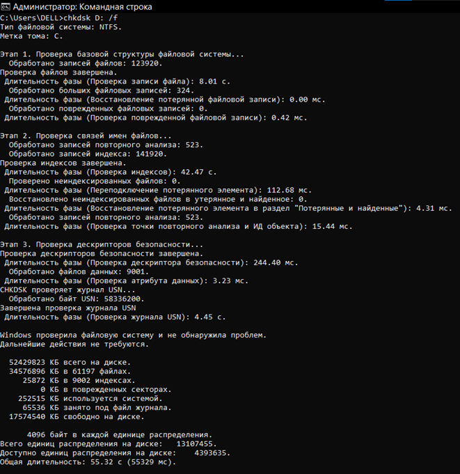

6 Отримала перелік критичних подій системного журналу за останній тиждень засобами PowerShell (`Get-WinEvent`). Здійснила пошук події з кодом 41 (Kernel-Power).

   * **Пояснення причини події 41:** Подія Kernel-Power (ID 41) реєструється системою тоді, коли Windows вимикається або перезавантажується некоректно (аварійно), без попереднього штатного завершення роботи. Вона з'явилася б за обставин раптового зникнення живлення, примусового вимкнення кнопкою Power, апаратного збою (BSOD) чи несправності блока живлення.

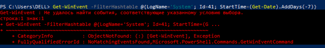

7 Створила тестовий каталог `C:\LabStudy` з текстовими файлами. За допомогою утиліти `robocopy` створила його резервну копію в каталозі `C:\LabBackup`. Видалила один із файлів з оригіналу та успішно відновила його з резервної копії, зафіксувавши обидві дії знімками екрана.

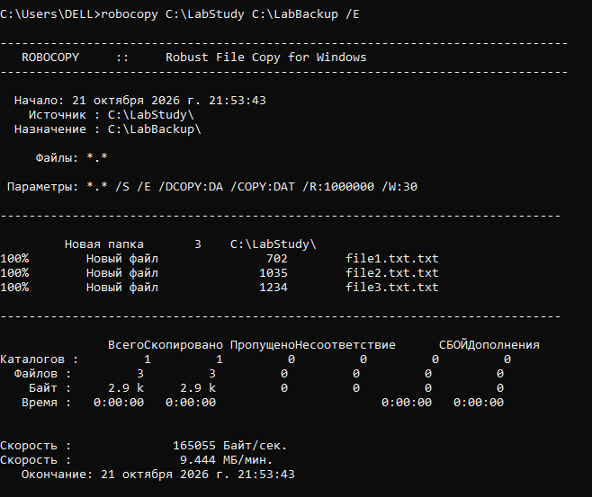

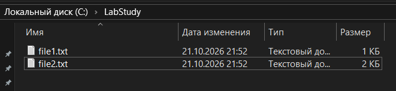

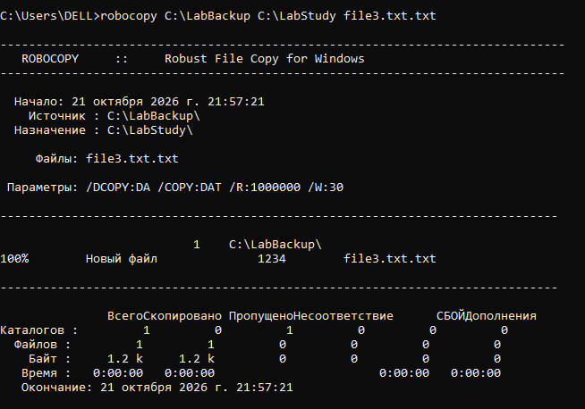

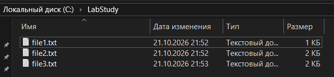

8 Сценарій відмови: невдале встановлення програми.

   * **Моделювання проблеми:** змоделювала ситуацію непередбачуваних змін у системі.
   * **Засіб відновлення:** використала штатний засіб Windows — точку відновлення системи (System Restore) шляхом відкату до раніше створеної точки `Lab_Butko_RestorePoint`.
   * **Обґрунтування за таблицею 1:** точка відновлення ідеально підходить для усунення наслідків невдалого встановлення програм, оскільки працює на рівні реєстру та системного сховища тіньових копій, повертаючи систему до стабільного стану «до встановлення» без втрати особистих файлів.

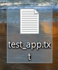

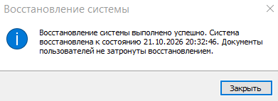

9 Перевірила конфігурацію завантаження за допомогою команди `bcdedit /enum`. Жодних змін у конфігурацію не вносила.

   * **Пояснення знайдених записів:** запис `{bootmgr}` керує глобальним диспетчером завантаження Windows (час очікування меню тощо), а запис `{current}` містить параметри завантаження поточної операційної системи (шлях до ядра, файл `winload.efi`, параметр `osdevice`).

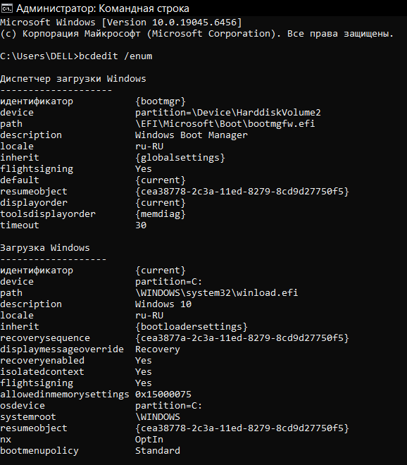

10 За допомогою утиліти `vssadmin` (`vssadmin list shadowstorage`) визначила обсяг дискового простору, відведений під тіньові копії та точки відновлення для диска `C:`, та зафіксувала ці параметри у звіті.

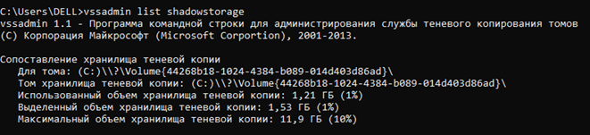

## Відповіді на контрольні питання

### Високий рівень (творчий)

1 **Після оновлення драйвера відеокарти система показує синій екран одразу після входу. Опишіть повний порядок відновлення із зазначенням засобу на кожному кроці й поясніть, чому саме в такій послідовності.**

Для усунення критичної помилки системи після оновлення драйвера слід застосувати поетапний порядок дій через середовище відновлення:

   * **Крок 1: запуск середовища відновлення та перехід у безпечний режим.** Засіб: параметри завантаження WinRE. Нормальний вхід неможливий через циклічний синій екран, викликаний ініціалізацією несправного драйвера, тому безпечний режим завантажує лише базові системні драйвери Microsoft, що дозволяє отримати доступ до інтерфейсу ОС.
   * **Крок 2: видалення або відкат проблемного драйвера.** Засіб: Диспетчер пристроїв (Device Manager) або утиліта DDU. У безпечному режимі можна видалити некоректний графічний драйвер, який спричиняє збій.
   * **Крок 3: перезавантаження у звичайний режим.** Засіб: стандартне перезавантаження системи. Після видалення конфліктного компонента ОС завантажує стандартний базовий драйвер, відновлюючи повноцінну працездатність комп'ютера.

Така послідовність обґрунтована тим, що усунути причину збою неможливо без попередньої ізоляції системи в безпечному середовищі.

2 **Користувач вимагає «щоб усе відновлювалося автоматично». Запропонуйте комбінацію засобів (точки відновлення, образ системи, файлові копії) і обґрунтуйте, від яких саме ризиків захищає кожен з них.**

Для забезпечення повного автоматизованого захисту слід застосувати комбінацію із трьох взаємодоповнюючих засобів:

   * **Точки відновлення (System Restore):** захищають від ризику системних збоїв, пошкодження реєстру чи системних файлів унаслідок встановлення неякісного програмного забезпечення або оновлень.
   * **Образ системи (System Image):** захищає від ризику катастрофічного апаратного збою (виходу з ладу накопичувача) або глибокого пошкодження структури розділів диска, оскільки є повною побітовою копією всього середовища.
   * **Файлові копії (File History / автоматичне резервне копіювання):** захищають від ризику людської помилки — випадкового видалення, перезапису чи пошкодження важливих персональних документів користувача.

Така комбінація перекриває всі рівні відмови — від помилок конфігурації ОС до апаратних поломок та втрати особистих даних.

3 **Точка відновлення створена, але відкат не усуває проблему. Назвіть щонайменше три причини, чому так буває, і спосіб перевірити кожну.**

Для виявлення причин неефективності відкату слід перевірити три основні фактори:

   1. **Апаратна несправність** (наприклад, збій оперативної пам'яті чи накопичувача), а не програмні зміни в ОС. **Спосіб перевірки:** виконати апаратну діагностику за допомогою вбудованого засобу перевірки пам'яті Windows або перевірити стан диска через командний рядок (`chkdsk`).
   2. **Глибоке зараження шкідливим ПЗ** (руткітами), яке блокує зміни або відновлює інфекцію на системному рівні. **Спосіб перевірки:** просканувати систему за допомогою зовнішнього завантажувального антивірусного носія (Offline Defender).
   3. **Пошкодження або нестача дискового простору для служби тіньового копіювання томів (VSS)**, через що сама точка відновлення виявилася неповною. **Спосіб перевірки:** перевірити стан служби та наявність помилок у Журналі подій (Event Viewer) або виконати команду `vssadmin list writers`.

4 **Сформулюйте критерій, за яким адміністратор обирає між відновленням системи і переустановленням з нуля. Оцініть обидва варіанти за часом, ризиком і збереженням даних.**

   * **Критерій вибору:** співвідношення часу на детальну діагностику й усунення несправності та прогнозованої стабільності відновленої системи порівняно з чистою установкою. Якщо пошук причини вимагає занадто багатьох ресурсів або не гарантує усунення глибинних збоїв, адміністратор надає перевагу переустановленню.
   * **Відновлення системи:** швидкий варіант (від кількох хвилин до пів години) із високим рівнем збереження даних та налаштувань користувача, проте має середній або високий ризик прихованого збереження системних помилок.
   * **Переустановлення з нуля (Clean Install):** вимагає значно більше часу (години на встановлення ОС, драйверів, оновлень і програм) та повністю видаляє дані з системного розділу, але забезпечує мінімальний ризик і гарантує стабільне та передбачуване робоче середовище.

## Висновок

Під час виконання лабораторної роботи №4 я ознайомилася з основними інструментами діагностики, захисту та відновлення ОС Windows. На основі проведеного аналізу я зробила висновок щодо різниці у застосуванні засобів відновлення:

* Штатні інструменти системи (DISM, SFC та точки відновлення) ефективно усувають програмні збої, пошкодження системних файлів і наслідки невдалого встановлення програм, оскільки відновлюють критичні компоненти та реєстр до стабільного стану без втрати особистих даних.
* Втрата, пошкодження чи випадкове видалення користувацьких файлів і документів усуваються виключно за допомогою попередньо створених резервних копій (наприклад, утилітою `robocopy`), оскільки системні точки відновлення не керують файлами користувача в робочих каталогах.
