<!--
  Принципи функціонування ОС Linux
  Варіант 2: Обсяг оперативної пам'яті — `/bin`, `/home`, `/tmp` — `mv` — `ssh` — Порівняти вивід `free -h` і `/proc/meminfo`

  Тему, мету й обладнання писати не треба — конвеєр візьме їх із лабораторної.
  Знімки екрана кладіть у assets/, вихідний код — у src/.
  Контрольні питання — лише одного рівня, того, на який захищаєте роботу:
  заголовок «### Достатній рівень», далі «1 Текст питання?» і відповідь.
  Покрокова інструкція — reports/README.md
-->

## Хід роботи

1 Я отримала у викладача індивідуальний варіант №2 та зафіксувала його параметри для подальшого виконання лабораторної роботи в середовищі віртуальної машини Ubuntu. Мій індивідуальний варіант містив такі завдання: дослідження параметра системи «Обсяг оперативної пам'яті», аналіз каталогів FHS (`/bin`, `/home`, `/tmp`), дослідження команди `mv`, роботу зі службою `ssh`, а також порівняння виводу команд `free -h` і `/proc/meminfo` як додаткове завдання.

2 Для складання паспорта операційної системи я відкрила термінал Ubuntu за допомогою комбінації клавіш `Ctrl + Alt + T` та послідовно виконала системні команди `uname -a`, `cat /etc/os-release`, `hostnamectl` і `uptime`. У результаті я отримала повну технічну інформацію про дистрибутив, ядро, архітектуру та час роботи системи.

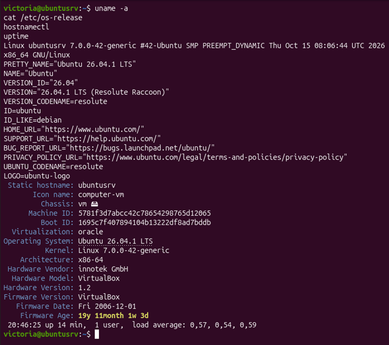

3 Для виконання завдання мого варіанта я зосередилася на визначенні обсягу оперативної пам'яті. У терміналі Ubuntu я виконала команду `free -h`, яка вивела дані у зручному для читання людиною форматі, а також перевірила перші рядки файлу `/proc/meminfo`.

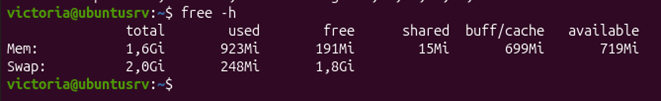

Я встановила, що загальний обсяг оперативної пам'яті (RAM) у моїй віртуальній машині становить 1,6 GiB. Для отримання цього параметра я використала утиліту `free` з прапорцем `-h` (human-readable).

4 Для дослідження ієрархії файлової системи за стандартом FHS я перейшла до кореневого каталогу за допомогою команди `cd /` та вивела повний перелік його вмісту за допомогою `ls -l`.

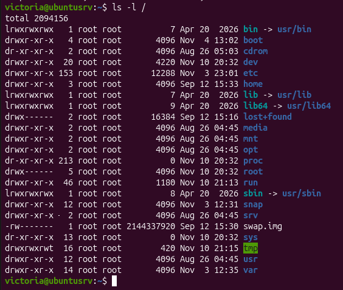

Я детально опрацювала та описала призначені за стандартом FHS каталоги мого варіанта:

   * **`/bin` (Essential command binaries):**
     * *Призначення:* містить основні виконувані бінарні файли системних команд, необхідні для завантаження та роботи системи в однокористувацькому режимі (`bash`, `ls`, `cp`, `mv`).
     * *Приклад файлу:* `/bin/ls` або `/bin/bash`.
   * **`/home` (Home directories):**
     * *Призначення:* кореневий каталог для розміщення домашніх директорій звичайних користувачів системи.
     * *Приклад файлу/каталогу:* `/home/student/Documents` або файл конфігурації у домашній директорії.
   * **`/tmp` (Temporary files):**
     * *Призначення:* призначений для зберігання тимчасових файлів, які створюються додатками або користувачами та можуть очищатися при перезавантаженні.
     * *Приклад файлу:* тимчасовий файл типу `/tmp/systemd-private-...` або створений мною файл `/tmp/test.txt`.

5 Для дослідження команди `mv` я виконала в терміналі серію перевірочних команд: `type mv`, `which mv`, `whatis mv` та переглянула довідку `mv --help`.

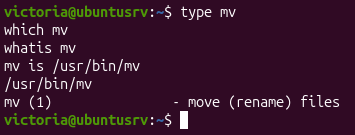

Я з'ясувала та зафіксувала такі характеристики команди `mv`:

   * **Чи є вбудованою:** ні, команда `mv` не є вбудованою в командну оболонку (*not a shell builtin*), це окрема зовнішня утиліта.
   * **Розташування виконуваного файлу:** `/usr/bin/mv`.
   * **Опис `whatis`:** `mv (1) - move or rename files` (переміщення або перейменування файлів і каталогів).
   * **Три ключі команди з поясненнями:**
     * `-i` (`--interactive`) — виводить попередження та запитує підтвердження перед перезаписом існуючого файлу.
     * `-f` (`--force`) — примусовий режим, який виконує операцію без запитів на підтвердження перезапису.
     * `-v` (`--verbose`) — виводить детальний звіт на екран про кожен переміщений чи перейменований файл.

6 Для пошуку команди засобами довідки за темою мого варіанта я скористалася утилітою `apropos`. Я ввела команду `apropos memory` у терміналі Ubuntu.

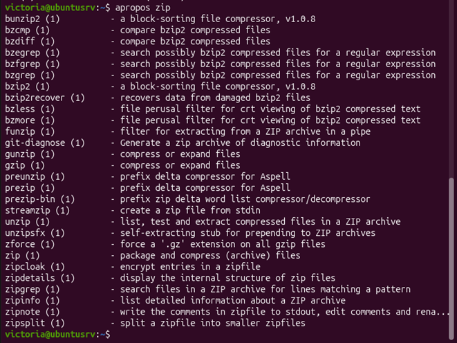

За допомогою `apropos memory` я просканувала базу даних man-сторінок за ключовим словом `memory`, після чого серед знайдених варіантів ідентифікувала утиліту `free`, яка призначена для перевірки обсягу оперативної пам'яті.

7 Для дослідження власного облікового запису я виконала команду `id`, після чого перевірила права доступу до системного файлу `/etc/shadow` без використання привілеїв суперкористувача та з ними.

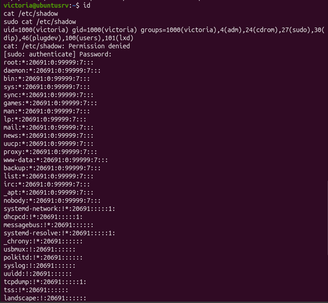

Я отримала та описала такі відомості:

   * **Відомості про обліковий запис:** команда `id` вивела мій `uid`, `gid` та список додаткових груп.
   * **Членство в групі `sudo`:** дає мені право виконувати адміністративні команди від імені суперкористувача (`root`) за допомогою префікса `sudo`.
   * **Демонстрація доступу до `/etc/shadow`:** без `sudo` система видала помилку `Permission denied`, оскільки файл містить зашифровані хеші паролів і доступний лише для `root`. З використанням `sudo` я успішно прочитала цей файл.

8 Для виконання цього пункту я спочатку перевірила наявність служби `ssh` та за необхідності встановила її за допомогою `sudo apt update && sudo apt install -y openssh-server`. Потім я дослідила процеси за допомогою `ps -ef`, вивела активні служби в стані `running` і перевірила статус служби `ssh`.

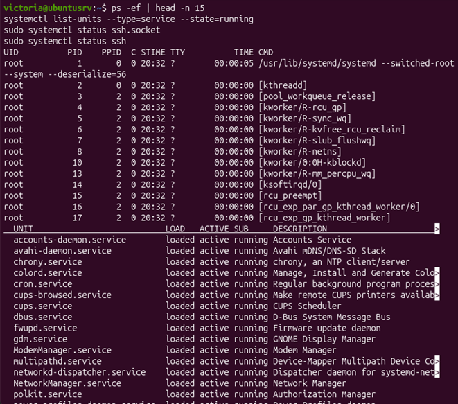

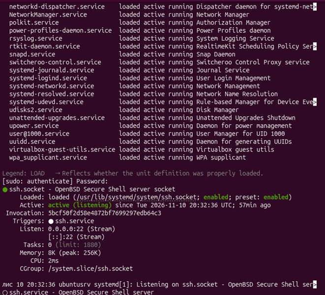

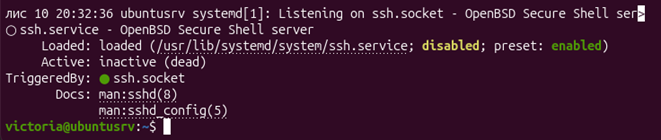

Я зафіксувала та пояснила результати:

   * **Процес із PID 1:** першим процесом у системі є ініціалізатор `systemd`.
   * **Служби в стані `running`:** виведено за допомогою команди `systemctl list-units --type=service --state=running`.
   * **Особливості служби `ssh` в Ubuntu 24.04:** я врахувала, що в сучасних версіях Ubuntu використовується механізм Socket Activation через `ssh.socket`. Це означає, що демон не обов'язково активний одразу після завантаження — він запускається системою `systemd` лише в момент надходження першого мережевого запиту на порт 22.

9 Для дослідження віртуальної файлової системи я зчитала три показники за допомогою команди `cat` та перевірила їхній розмір на диску.

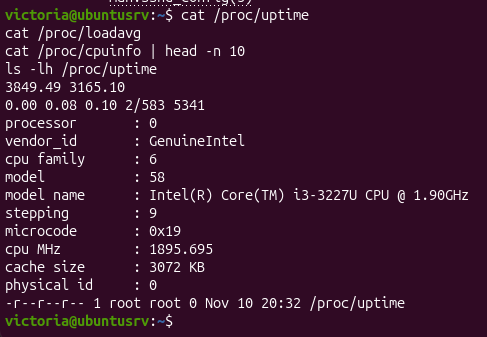

Я отримала та описала такі показники:

   * `/proc/uptime` — час безперебійної роботи системи в секундах.
   * `/proc/cpuinfo` — технічні характеристики процесора.
   * `/proc/meminfo` — статистика використання пам'яті.

Я пояснила, чому ці файли не займають місця на диску: каталог `/proc` є віртуальною псевдофайловою системою, яка генерується ядром Linux безпосередньо в оперативній пам'яті (RAM) під час звернення, тому їхній реальний розмір на диску дорівнює нулю (0 байтів).

10 Як додаткове завдання для мого варіанта я виконала порівняння виводу утиліти `free -h` та вмісту файлу `/proc/meminfo`.

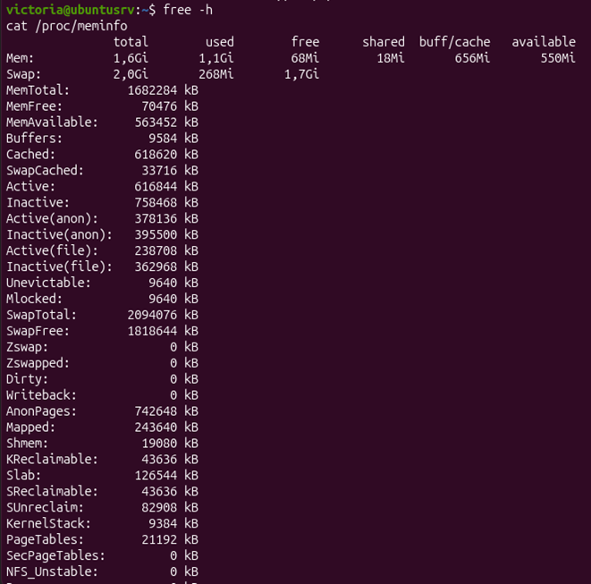

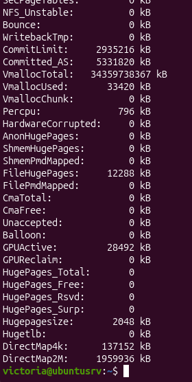

Я порівняла результати роботи обох інструментів. Утиліта `free -h` виводить дані у вигляді компактної, наочної таблиці, де інформація структурована за рядками (`Mem`, `Swap`) та стовпчиками (`total`, `used`, `free`, `shared`, `buff/cache`, `available`). Натомість файл `/proc/meminfo` містить детальний вертикальний список усіх можливих параметрів пам'яті у форматі «Ключ: Значення».

Щодо одиниць виміру, то утиліта з прапорцем `-h` автоматично адаптує показники для зручного сприйняття людиною, відображаючи їх у гігабайтах чи мегабайтах (GiB, MiB), тоді як файл `/proc/meminfo` за замовчуванням подає значення в кілобайтах (kB).

За своїм призначенням утиліта `free -h` ідеально підходить для швидкого загального огляду поточного стану оперативної пам'яті та простору підкачки в реальному часі. Водночас файл `/proc/meminfo` використовується для надання вичерпної, низькорівневої та детальної статистики, яка задіюється системними адміністраторами, різноманітними скриптами та системами моніторингу.

## Відповіді на контрольні питання

### Високий рівень (творчий)

1 **Поясніть принцип «все є файлом» в Linux та проілюструйте його прикладом.**

   Принцип «все є файлом» означає, що доступ до апаратних пристроїв, процесів, сокетів та інформації ядра здійснюється через стандартні файлові операції та системні виклики (`open`, `read`, `write`, `close`). Це значно спрощує написання системних утиліт, оскільки розробникам не потрібно створювати унікальні інтерфейси взаємодії для кожного окремого компонента системи — достатньо стандартних механізмів роботи з файловими дескрипторами. Проілюструвати це можна на прикладі зчитування відомостей про центральний процесор: замість складених низькорівневих запитів до архітектури CPU, утиліта чи скрипт може просто відкрити та прочитати текстовий псевдофайл `/proc/cpuinfo` за допомогою звичайних функцій читання (наприклад, командою `cat /proc/cpuinfo`), отримуючи актуальні дані безпосередньо від ядра в зручному текстовому форматі.

2 **Які наслідки для адміністратора має різниця у версіях ядра за однакового дистрибутива?**

   Різниця у версіях ядра за однакового дистрибутива створює кілька важливих наслідків для адміністратора. По-перше, виникає різниця у підтриманні апаратного забезпечення: новіша версія ядра містить свіжі драйвери, виправлення помилок та оптимізації для новітніх процесорів чи контролерів, тоді як старе ядро може не розпізнати нове обладнання. По-друге, відрізняється рівень безпеки та наявність патчів проти вразливостей (CVE): новіше ядро зазвичай захищене від актуальних експлойтів, тоді як старе може потребувати ручного бекпортування виправлень. По-третє, оновлене ядро може надавати нові системні виклики або можливості підсистеми віртуалізації й контейнеризації (наприклад, нові версії `cgroups` чи `namespaces`), від яких залежить коректна робота сучасного програмного забезпечення.

3 **За якими критеріями слід обирати дистрибутив для навчального класу?**

   Вибір дистрибутива для навчального класу базується на кількох ключових критеріях. Першим критерієм є стабільність та довгострокова підтримка (LTS), оскільки навчальний процес потребує передбачуваного й незмінного середовища протягом семестру без ризику ламання системи через регулярні масові оновлення. Другим критерієм є широка поширеність і наявність документації, адже популярні дистрибутиви мають величезні масиви навчальних матеріалів, форумів і готових інструкцій, що допомагає студентам самостійно знаходити рішення проблем. Третім критерієм є багатство репозиторіїв програмного забезпечення та зручність менеджерів пакетів (на кшталт `apt`), що дозволяє швидко та безперешкодно встановлювати необхідні для лабораторних робіт середовища розробки, компілятори та утиліти.

4 **Як діагностувати та усунути проблему зі службою, яка не працює?**

   Для діагностики та усунення проблеми з непрацюючою службою застосовується послідовність дій із використанням утиліт `systemctl` та `journalctl`. На першому етапі за допомогою команди `systemctl status <назва_служби>` перевіряється поточний стан служби, щоб виявити код завершення помилки, статус активації (`failed`, `inactive`) та загальний опис проблеми. На другому етапі корисно виконати `systemctl --failed`, щоб перевірити весь перелік служб, які зазнали невдачі під час запуску системи, та виявити можливі ланцюгові збої залежностей. На третьому етапі за допомогою команди `journalctl -u <назва_служби> -b` переглядаються детальні системні логи журналу саме для цієї служби за поточний сеанс завантаження, де шукаються конкретні рядки помилок, проблеми з конфігураційними файлами або брак прав, які безпосередньо призвели до зупинки демона.

## Висновок

Під час виконання лабораторної роботи я ознайомилася з будовою операційної системи Linux на практиці: навчилася визначати версію ядра й дистрибутива, орієнтуватися в структурі каталогів, працювати з базовими командами оболонки, отримувати довідку штатними засобами, спостерігати за процесами та станом служб `systemd`.
