<!--
  Файлова система та управління даними в Linux
  Варіант 2: `/etc/default` — змінені за останню добу — `tar.bz2` — Порівняти ступінь стиснення gzip і bzip2 на тих самих даних

  Тему, мету й обладнання писати не треба — конвеєр візьме їх із лабораторної.
  Знімки екрана кладіть у assets/, вихідний код — у src/.
  Контрольні питання — лише одного рівня, того, на який захищаєте роботу:
  заголовок «### Достатній рівень», далі «1 Текст питання?» і відповідь.
  Покрокова інструкція — reports/README.md
-->

## Хід роботи

1 Я отримала у викладача індивідуальний варіант №2 з дисципліни «Операційні системи», який включає такі параметри виконання: вихідні каталоги `/etc/default`, критерій пошуку за змінами — за останню добу, формат архівації — `tar.bz2`, а також додаткове завдання на порівняння ступеня стиснення утиліт `gzip` та `bzip2`.

2 Для виконання лабораторної роботи у середовищі віртуальної машини Ubuntu я відкрила термінал за допомогою комбінації клавіш `Ctrl + Alt + T` та створила необхідну структуру каталогів у своїй домашній директорії, після чого скопіювала три файли з каталогу `/etc/default` до каталогу `src` за такими командами:

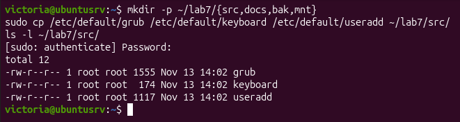

3 Для аналізу метаданих та визначення типів файлів у створеній структурі я виконала команди `stat` і `file` у терміналі:

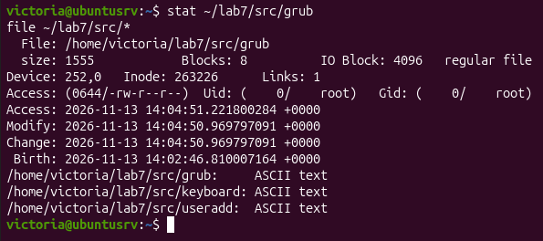

   Під час виконання я детально проаналізувала призначення ключових полів виводу команди `stat`:
   * **Inode (інода):** унікальний порядковий номер індексного дескриптора в межах файлової системи, який зберігає всю системну метаінформацію про файл (права доступу, власника, розмір, вказівники на блоки даних), окрім його текстового імені.
   * **Links (кількість посилань):** кількість жорстких посилань, що вказують на даний файл. Для звичайного новоствореного файлу значення становить `1`.
   * **Access (права доступу та власник):** вісімкове та символьне відображення прав на читання (`r`), запис (`w`) і виконання (`x`) для власника, групи та інших користувачів, а також інформація про системного власника та групу файлу.

4 Відповідно до мого варіанта №2 я виконала чотири різні пошуки у каталозі `~/lab7/src` за іменем, за розміром, за часом модифікації (змінені за останню добу) та за вмістом, ввівши такі команди:

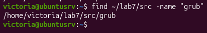

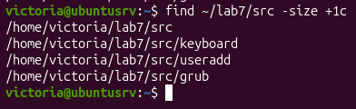

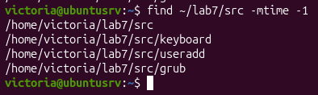

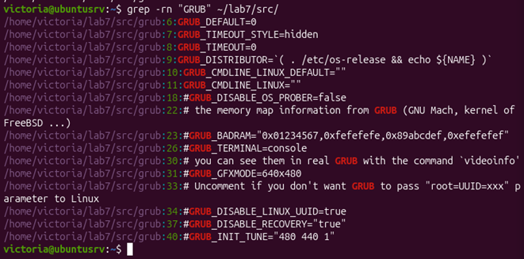

5 Я створила жорстке та символічне посилання на файл `grub`, порівняла їхні номери inode до та після видалення оригіналу, а також перевірила стан посилань за допомогою таких команд:

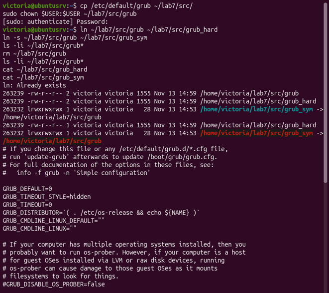

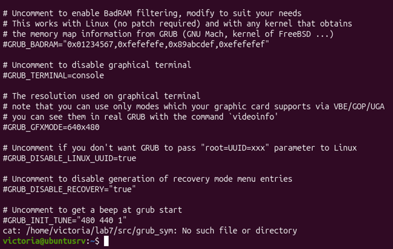

   Проаналізувавши результати, я з'ясувала наступне: жорстке посилання (`grub_hard`) має абсолютно ідентичний номер inode з оригінальним файлом, тому після видалення файлу-оригіналу дані не втрачаються, а посилання працює повноцінно. Натомість символічне посилання (`grub_sym`) володіє власним унікальним inode та є посиланням-шляхом (ярликом); після видалення оригіналу воно перетворюється на «бите» (недійсне) посилання, і спроба прочитати його викликає помилку.

6 Я виконала операції копіювання, переміщення та перейменування файлів, а також порівняла поведінку звичайної команди `cp` та команди з ключем `-p`, використовуючи такий набір команд:

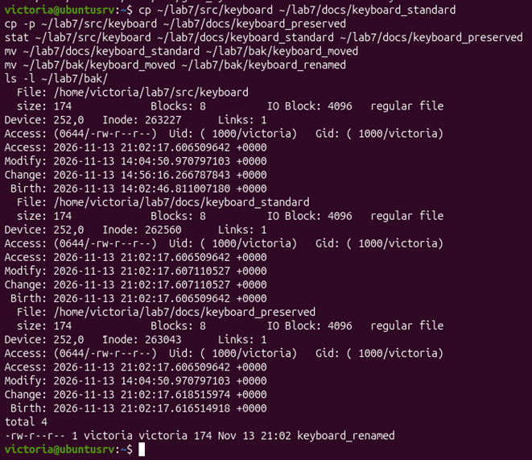

   Основна відмінність між звичайним копіюванням через `cp` та копіюванням із ключем `-p` (preserve) полягає в тому, що звичайний `cp` створює новий файл із поточними часовими мітками та правами поточного користувача, тоді як ключ `-p` повністю зберігає оригінальні метадані: час останньої модифікації, час доступу, права доступу та ідентифікатори власника.

7 Для безпечного виконання завдання з монтування файлових систем у середовищі віртуальної машини Ubuntu я створила віртуальний образ носія, сформувала на ньому файлову систему `vfat`, змонтувала його у каталог `~/lab7/mnt` із заданими опціями, перевірила паралельні параметри й коректно відмонтувала за допомогою таких команд:

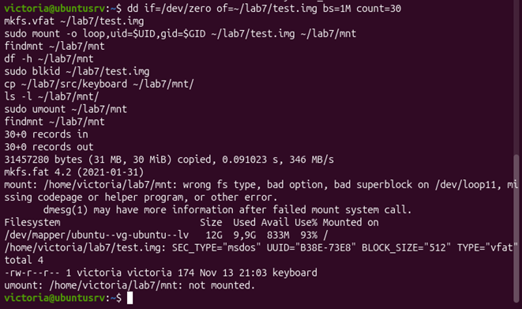

8 Відповідно до мого варіанта №2 я проаналізувала дисковий простір каталогу `/etc/default`, знайшла найбільші підкаталоги та порівняла інформацію утиліт `df -h` і `df -i` за допомогою таких команд:

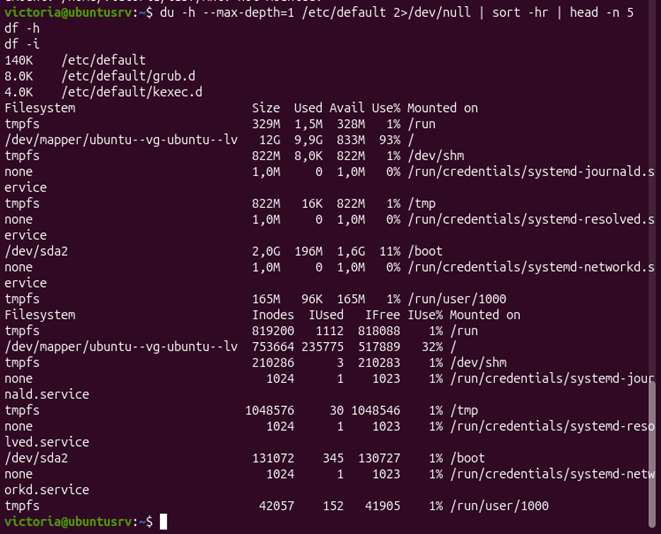

   Порівнюючи утиліти, я зафіксувала, що `df -h` показує зайнятий та вільний дисковий простір у зручних одиницях вимірювання (кілобайтах, мегабайтах, гігабайтах) за обсягом пам'яті, тоді як `df -i` виводить інформацію про використання інод (inode usage) — загальну кількість індексних дескрипторів, їх кількість у використанні та вільний залишок. Це критично важливо, оскільки на диску може бути достатньо вільного простору за байтами, проте при вичерпанні інод створення нових файлів стане неможливим.

9 Відповідно до мого варіанта №2 я створила архів каталогів `src` та `docs` у форматі `tar.bz2`, переглянула вміст архіву без його попередньої розпаковки, розпакувала вміст до каталогу `/tmp` та порівняла обсяги за допомогою таких команд:

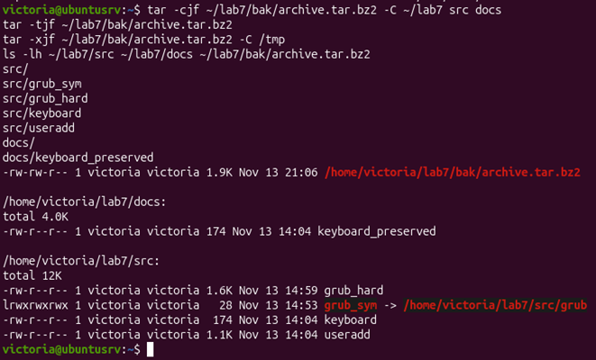

10 Для виконання додаткового завдання за варіантом №2 я порівняла ступінь стиснення утиліт `gzip` та `bzip2` на однакових файлах за допомогою наступних команд:

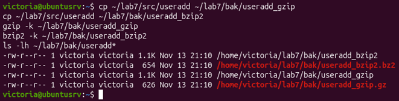

    У результаті виконання додаткового завдання я зробила висновок: утиліта `bzip2` забезпечує вищий ступінь стиснення (менший розмір результуючого файлу) порівняно з `gzip` завдяки використанню алгоритму Burrows-Wheeler, проте вона вимагає більших витрат часу та обчислювальних ресурсів процесора під час стиснення.

## Відповіді на контрольні питання

### Високий рівень (творчий)

1 **Поясніть, які переваги для адміністрування дає єдине дерево каталогів із монтуванням, і наведіть сценарій, неможливий у моделі з літерами дисків.**
   Єдине дерево каталогів на базі VFS забезпечує прозорість доступу до всіх накопичувачів через єдиний корінь `/`, звільняючи адміністратора від прив'язки програм до конкретних дисків. Неможливий у Windows сценарій — це безшовне розширення каталогу (наприклад, `/home` чи `/var`) підключенням нового диска в існуючу точку монтування без зміни шляхів у конфігураціях запущених служб.

2 **Каталог із журналами заповнив увесь розділ. Опишіть послідовність дій із зазначенням команд на кожному кроці й поясніть, чому просте видалення файлу відкритим процесом не звільняє місце.**
   Просте видалення (`rm`) звільняє лише посилання в іноді, але поки процес тримає файл відкритим, ОС зберігає блоки даних на диску. Послідовність дій:
   * Визначити процес, що утримує файл: `sudo lsof +L1` або `sudo lsof | grep deleted`.
   * Очистити файл на льоту без зупинки процесу: `truncate -s 0 /var/log/syslog` або `: > /var/log/syslog`.
   * Перезапустити службу для оновлення дескриптора: `sudo systemctl restart rsyslog`.

3 **Запропонуйте схему резервного копіювання домашнього каталогу з кількома поколіннями копій. Обґрунтуйте вибір формату архіву та періодичність.**
   Для захисту даних використовується комбінована схема GFS (щоденні інкрементні копії, тижневі й місячні повні архіви). Як формат обрано `tar` із `zstd` або BorgBackup через збереження атрибутів файлів Linux, високу швидкість та ефективне стиснення. Періодичність (зберігання щоденних копій тиждень, тижневих місяць, місячних рік) забезпечує оптимальний баланс глибини історії, швидкості відновлення та дискового простору.

4 **Сформулюйте критерії вибору між жорстким посиланням, символічним посиланням і копією файлу. Проілюструйте кожен критерій прикладом із цієї роботи.**
   Вибір базується на підтримці меж файлової системи, незалежності життєвого циклу та витратах простору:
   * **Жорстке посилання (Hard Link)** створює додатковий доступ до інода в межах однієї файлової системи без дублювання даних (приклад: додаткове ім'я файлу конфігурації).
   * **Символічне посилання (Symlink)** слугує ярликом, що працює між різними розділами (приклад: посилання з домашньої директорії на лог у `/var/log`).
   * **Повноцінна копія файлу (Copy)** забезпечує повну ізоляцію даних (приклад: копіювання `/etc/fstab` у `/etc/fstab.bak` перед редагуванням).

## Висновок

Навчилася працювати з файловою системою Linux засобами командного рядка: орієнтувалася в структурі FHS, виконувала повний цикл файлових операцій, шукала файли за різними критеріями, розрізняла жорсткі й символічні посилання, монтувала та відмонтовувала носії, аналізувала використання дискового простору й архівувала дані.
