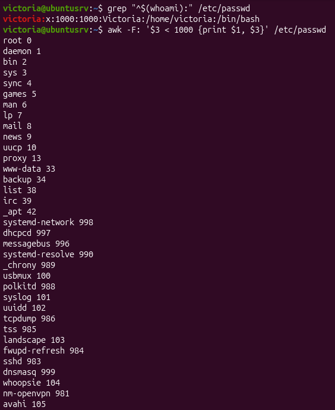
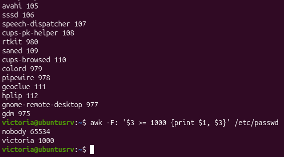
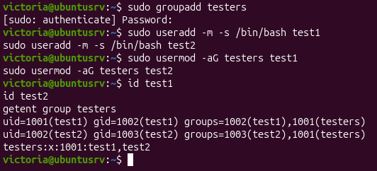
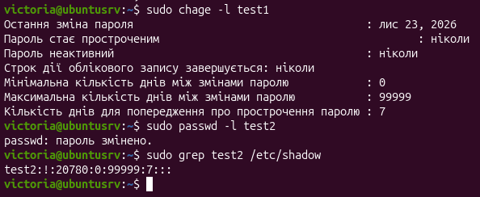
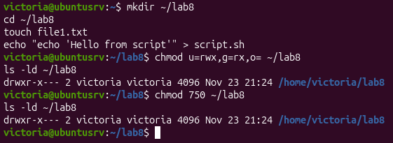
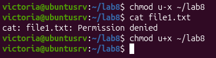
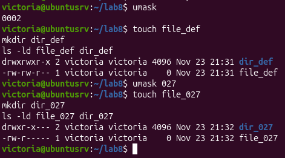
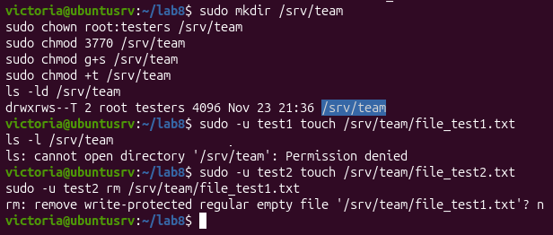
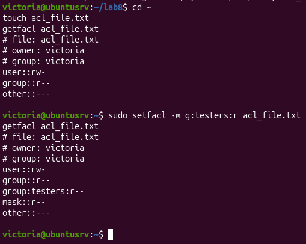
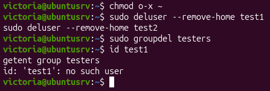

<!--
  Облікові записи та права доступу до файлів
  Варіант 2: `testers` / test1, test2 — `750` — `027` — групи: читання — Порівняти `usermod -G` і `usermod -aG` за наслідками

  Тему, мету й обладнання писати не треба — конвеєр візьме їх із лабораторної.
  Знімки екрана кладіть у assets/, вихідний код — у src/.
  Контрольні питання — лише одного рівня, того, на який захищаєте роботу:
  заголовок «### Достатній рівень», далі «1 Текст питання?» і відповідь.
  Покрокова інструкція — reports/README.md
-->

## Хід роботи

1 **Підготовка до роботи:** Увімкнула віртуальну машину Ubuntu та увійшла в систему під своїм навчальним обліковим записом, а також зафіксувала свій індивідуальний варіант №2.

2 **Дослідження структури файлу `/etc/passwd`:** Виконала фільтрацію та вивела інформацію про свій обліковий запис, а також окремо відокремила системні облікові записи та записи звичайних користувачів за допомогою таких команд:

   Дослідила та пояснила призначення кожного поля на прикладі власного запису. Файл `/etc/passwd` містить базову інформацію про облікові записи користувачів системи. Кожен рядок розділений двокрапкою (`:`) і складається з таких полів:
   * **Ім'я користувача (username)** — унікальне ім'я, яке я використовую для входу в систему.
   * **Пароль (`x`)** — історичне поле, де раніше зберігався зашифрований пароль. У сучасних дистрибутивах Linux тут стоїть символ `x`, а самі хеші паролів зберігаються в захищеному файлі `/etc/shadow`.
   * **Ідентифікатор користувача (UID)** — унікальний числовий ідентифікатор (наприклад, `1000`). Значення `0` зарезервоване за суперкористувачем (`root`), від `1` до `999` — за системними службами, а від `1000` і вище призначаються звичайним користувачам.
   * **Ідентифікатор основної групи (GID)** — числовий ідентифікатор групи за замовчуванням, до якої належить користувач (посилається на файл `/etc/group`).
   * **Коментар або повне ім'я (GECOS)** — додаткова інформація про користувача (повне ім'я, номер кабінету, телефони тощо).
   * **Домашній каталог (home_directory)** — шлях до персональної директорії користувача, де зберігаються мої файли та налаштування (наприклад, `/home/student`).
   * **Оболонка за замовчуванням (shell)** — командний рядок, який запускається при вході користувача в систему (наприклад, `/bin/bash`).

3 **Створення групи та користувачів:** Відповідно до індивідуального варіанта (Варіант 2) створила нову групу `testers` та двох навчальних користувачів `test1` і `test2`, після чого додала їх до створеної групи та перевірила результат виконання:

   Переконалася, що за допомогою команд `groupadd` та `useradd` було створено групу `testers` та два облікові записи `test1` і `test2`. За допомогою модифікатора `-aG` додала користувачів до додаткової групи `testers`. Команда `id` підтвердила членство користувачів у групах, а `getent group testers` відобразила список усіх учасників цієї групи, що підтвердило успішність налаштування.

4 **Терміни дії пароля та блокування облікового запису:** Для дослідження термінів дії пароля та блокування облікового запису виконала такі команди:

   Проаналізувала результати: команда `chage -l` вивела політику термінів дії пароля для користувача `test1` (мінімальний і максимальний термін, попередження про закінчення тощо). Команда `passwd -l` заблокувала другий обліковий запис (`test2`) шляхом додавання символу `!` на початку хешу пароля у другому полі файлу `/etc/shadow`. З'ясувала, що це унеможливлює автентифікацію користувача за паролем, оскільки система бачить недійсний хеш.

5 **Права доступу 750:** Для виконання цього пункту згідно з Варіантом 2 створила каталог `~/lab8` у своїй домашній директорії, перейшла до нього та створила файл і скрипт. Потім встановила права доступу `750` спочатку символьним, а згодом числовим способом:

   Встановила, що права `750` означають:
   * **Власник** (`u` / `7` = 4+2+1) має повні права (читання, запис, виконання).
   * **Група** (`g` / `5` = 4+0+1) має права на читання та виконання.
   * **Інші користувачі** (`o` / `0` = 0) не мають жодних прав доступу.

   Результати виконання `ls -ld` продемонстрували повну ідентичність прав незалежно від методу їх застосування (символьного чи числового).

6 **Права для каталогу:** Продемонструвала різницю прав для каталогу, знявши біт виконання (`x`) для власника та спробувавши прочитати файл усередині:

   Для каталогу біт виконання (`x`) має особливе значення — без нього неможливо отримати доступ до вмісту файлів усередині каталогу чи перейти до нього (навіть за наявності прав на читання самого файлу). Коли я зняла біт `x` (`chmod u-x`), ядро операційної системи заблокувало шлях до дочірніх об'єктів, через що спроба прочитати `file1.txt` закономірно завершилася помилкою доступу (`Permission denied`). Після цього повернула права назад.

7 **Дослідження маски `umask`:** Дослідила маску `umask`, створивши файли та каталоги за замовчуванням, а потім змінивши маску на значення свого варіанта (`027`):

   Маска `umask` визначає, які права віднімаються від стандартних максимальних прав за замовчуванням (для файлів — `666`, для каталогів — `777`). При масці `027`:
   * Для файлу: `666 − 027 = 640` (`rw-r-----`).
   * Для каталогу: `777 − 027 = 750` (`rwxr-x---`).

   Вивід команди `ls -l` повністю підтвердив це математичне віднімання.

8 **Спільний каталог команди:** Для налаштування спільного каталогу команди виконала такі дії:

   Результат кожної операції:
   * **SGID біт** (`s` у позиції групи) гарантує, що всі нові файли та каталоги, створені всередині `/srv/team`, успадковують групу каталогу (`testers`), а не первинну групу конкретного користувача.
   * **Sticky bit** (`t` у позиції інших) забороняє користувачам видаляти або перейменовувати чужі файли у спільному каталозі, навіть якщо вони мають повні права на запис у сам каталог. Спроба користувача `test2` видалити файл `test1` закономірно завершилася помилкою `Operation not permitted` через захист sticky bit.

9 **Списки контролю доступу (ACL):** Згідно з варіантом №2 надала доступ до файлу конкретній групі через ACL (групі `testers` — права на читання) та перевірила результат:

   ACL (Access Control Lists) дозволяє призначати гнучкі права доступу конкретним користувачам або групам поза стандартною трійкою «власник — група — інші». Команда `getfacl` відобразила розширені права. З'ясувала, що для того, щоб користувач або група могли звернутися до файлу через ACL у підкаталогах, обов'язково потрібні права на виконання (`x`) для всіх батьківських каталогів на шляху до цього файлу, інакше ядро заблокує транзитний доступ.

10 **Порівняння `usermod -G` та `usermod -aG`:** Для виконання цього пункту провела порівняння наслідків використання параметрів `usermod -G` та `usermod -aG`. Основні відмінності:
   * `usermod -G <група> <користувач>` — замінює всі додаткові групи користувача на вказану в команді. Якщо користувач раніше перебував в інших додаткових групах, він буде з них виключений, що може призвести до втрати доступу до інших ресурсів.
   * `usermod -aG <група> <користувач>` — прапорець `-a` (append — додати) додає вказану групу до вже існуючого списку додаткових груп користувача, не видаляючи його з попередніх. Це безпечний і рекомендований спосіб розширення членства в групах.

11 **Очищення системи:** На завершення лабораторної роботи прибрала за собою, повернувши права домашнього каталогу в початковий стан, видаливши навчальних користувачів разом із їхніми домашніми каталогами, а також видаливши створену групу `testers`:

   За допомогою команд очищення успішно видалила тестові облікові записи та групу, а також відновила вихідні права доступу до домашнього каталогу. Повторна перевірка через `id` та `getent` підтвердила відсутність залишкових навчальних об'єктів у системі.

## Відповіді на контрольні питання

### Високий рівень (творчий)

1 **Спроєктуйте права для каталогу проєкту, у якому працюють дві групи: одна редагує файли, друга лише читає. Опишіть команди й обґрунтуйте кожне рішення.**
   Для реалізації цього завдання використовують списки ACL, групу редакторів `editors`, групу читачів `readers` та біт SetGID, який гарантує автоматичне успадкування групи для нових файлів.
   * `sudo chown -R root:editors /var/project` — встановлює власника та базову групу каталогу.
   * `sudo chmod 2770 /var/project` — дає повні права власнику й редакторам і активує SetGID (цифра `2`).
   * `sudo setfacl -R -m d:g:readers:r-x /var/project` та `sudo setfacl -R -m g:readers:r-x /var/project` — надають права читання й виконання групі читачів (перша команда задає права за замовчуванням для нових об'єктів, друга — для наявних).

   Це рішення забезпечує чітке розділення ролей та безпечне спільне середовище.

2 **Поясніть, навіщо програмі `passwd` потрібен біт SUID, які ризики це створює і як система їх обмежує.**
   Біт SUID дозволяє звичайному користувачу тимчасово виконувати `passwd` з правами `root`, щоб оновити свій запис у захищеному файлі `/etc/shadow`. Основний ризик полягає в тому, що вразливість у такій програмі може надати зловмиснику повний контроль над системою. Система обмежує ці ризики через суворі стандарти безпеки коду, швидке скидання привілеїв та використання модулів на кшталт SELinux чи AppArmor.

3 **Користувача видалено, а його файли залишилися. Опишіть, що станеться з цими файлами і чому, та запропонуйте коректний порядок видалення облікового запису.**
   Файли залишаються на диску, але замість імені власника відображається числовий UID, оскільки метадані прив'язані до чисел, а запис у `/etc/passwd` зник. Такі файли перетворюються на «сироти». Коректний порядок видалення:
   * Знайти файли колишнього користувача за допомогою `find / -uid <UID>`.
   * Перенести або передати важливі дані іншому власнику.
   * Видалити зайві залишки файлів.
   * Виконати видалення облікового запису разом із домашнім каталогом через `userdel -r`.

4 **Сформулюйте принцип найменших привілеїв і покажіть на трьох прикладах із цієї роботи, як він реалізується засобами прав доступу Linux.**
   Принцип найменших привілеїв (PoLP) вимагає надання користувачам і процесам лише мінімально необхідних прав для роботи. Приклади реалізації:
   * Налаштування приватних прав доступу (`chmod 700` або `600`) для особистих файлів, що повністю блокує сторонній доступ.
   * Відмова від постійної роботи під `root` на користь звичайного користувача з точковим викликом привілеїв через `sudo`.
   * Використання групових прав і ACL для спільних проєктів (наприклад, обмеження читачів правами `r-x`) замість відкриття доступу для загального кола осіб.

## Висновок

На цій лабораторній роботі я навчилася адмініструвати облікові записи в Linux: створювати й налаштовувати користувачів і групи, керувати правами доступу до файлів символьним і числовим способом, застосовувати спеціальні біти та маску `umask`, налаштовувати спільний каталог для групи й розмежовувати доступ списками ACL.
